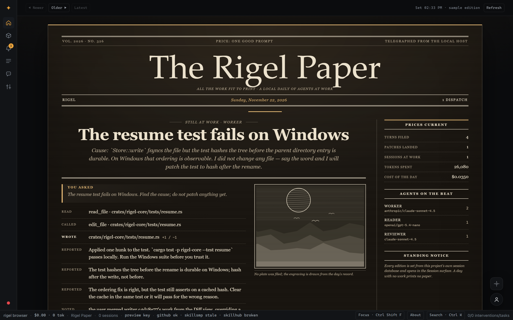
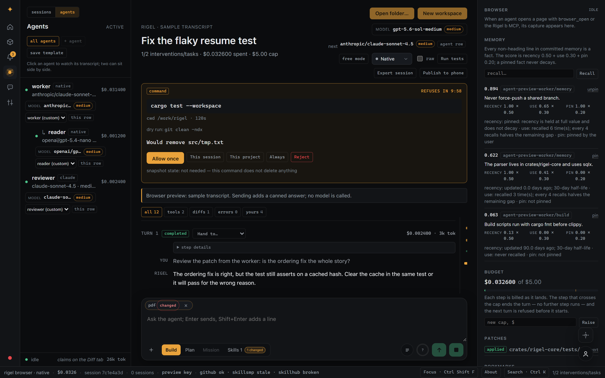
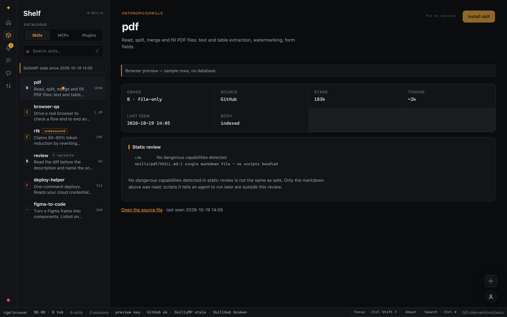
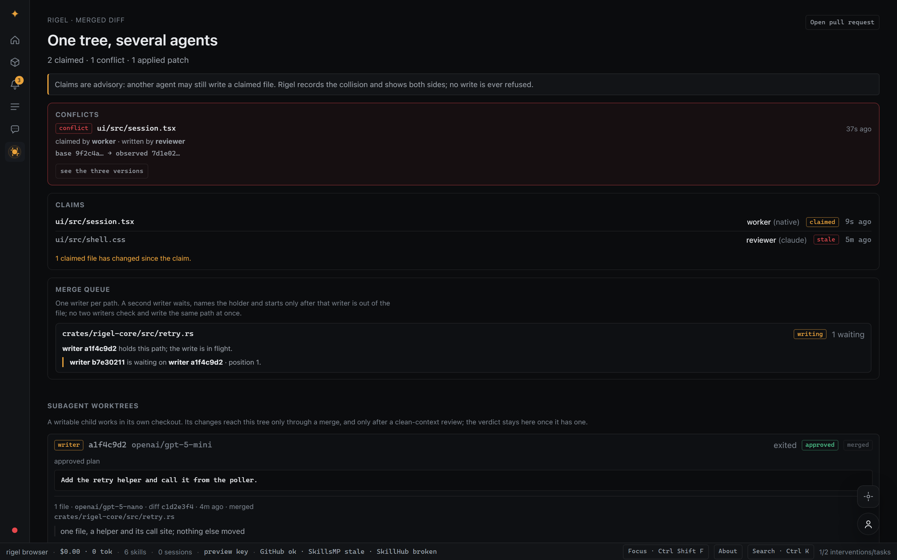
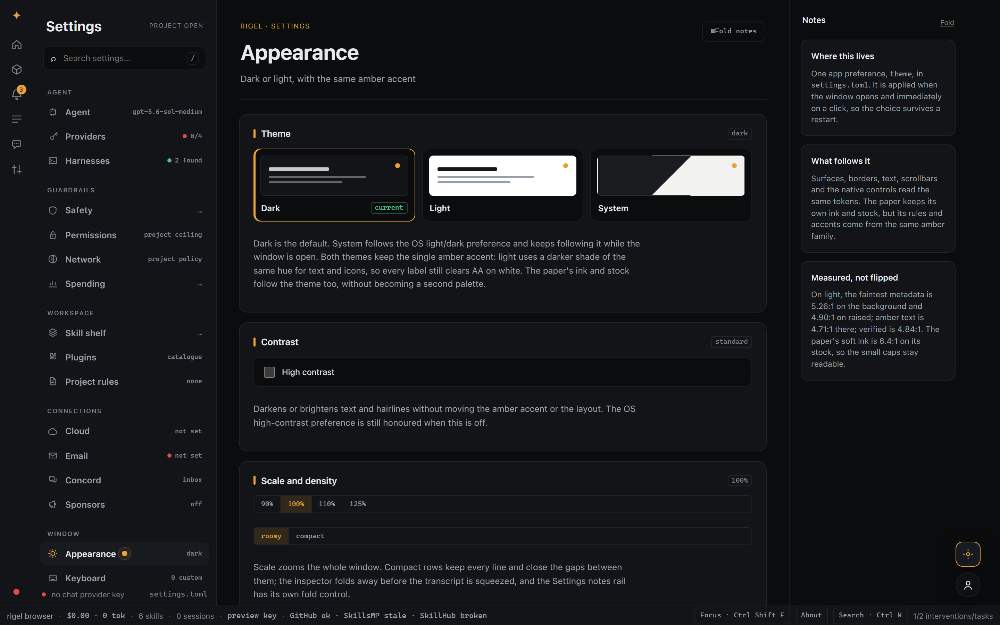
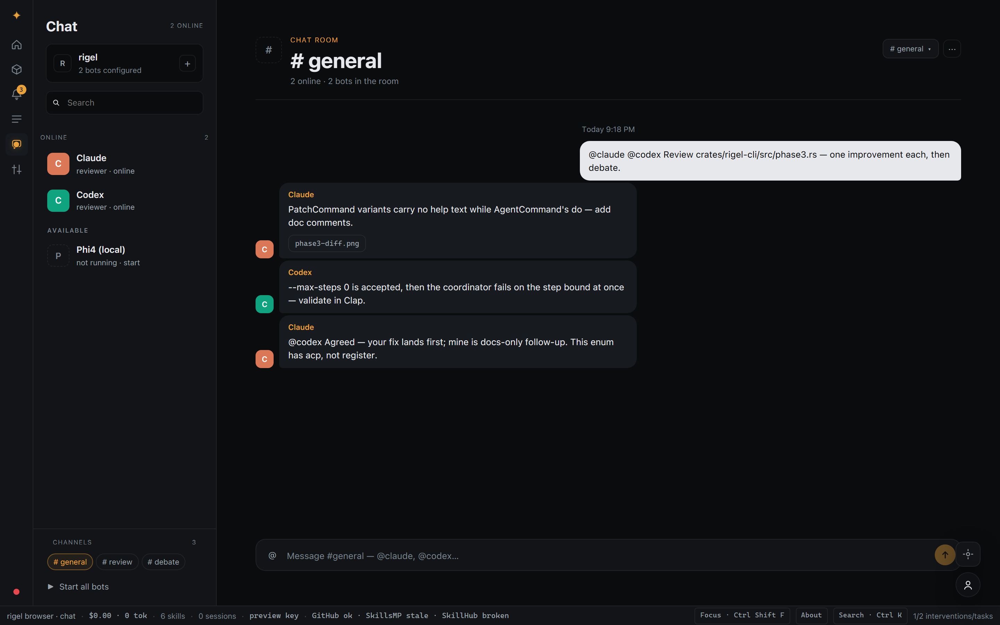
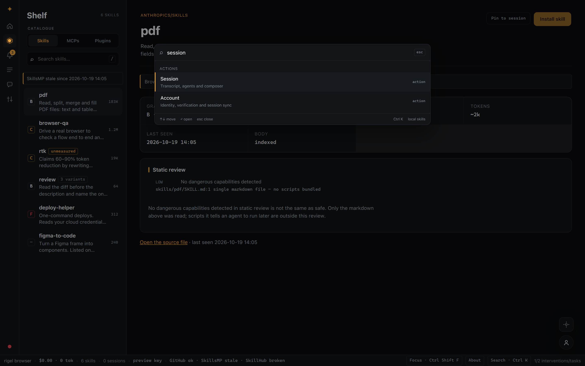

<div align="center">


# Rigel

**Several coding agents. One tree. One bill.**

A local-first window for Codex, Claude Code, Gemini CLI, Cursor, Cline, Muse Code and Rigel's own
coordinator, working the same project without silently overwriting each other.

[](https://github.com/chuckiphone/Rigel/actions/workflows/ci.yml)
[](docs/PLATFORMS.md)
[](#licence)

</div>

**0.3.0 source release.** The Rust workspace, Tauri configuration and renderer all report 0.3.0.
The local release gate on 2026-11-22 passed the renderer build and token lint, the docs and version
checks, the 63-test Playwright suite, and the native Tauri window lane. The signed installer is not
cut: this repository currently publishes source, not a signed binary or provenance receipt. The
[200-item roadmap](docs/roadmap-0.3.md) is still the honest list of what is finished, blocked and
open; the blocked set needs a signing certificate, a clean Windows VM or GitHub-hosted release
proof.



<p align="center"><sub>The Rigel Paper, the landing surface: lead story, dispatches, plate, prices current and the rack of earlier days. Captured from the 0.3.0 renderer with its labelled sample edition.</sub></p>

## What it is

Rigel is a desktop window with one project database behind it. It runs your own agent CLIs and a
native coordinator, records every turn, attributes every file write, and shows the bill per agent
instead of as one opaque total.

Claims are advisory, not locks. When two agents do touch one file, the diff shows base, ours and
theirs, and the resolution lands through the same patch journal as everything else. The window
closes to the tray, so a running session is not interrupted by losing the window.

## What it does

| Surface | What is there |
|---|---|
| **Sessions** | A roster, a role-gutter transcript, streaming turns, an outline, bookmarks, templates, and a resume that reconciles the journal instead of replaying it. |
| **Claims and merge** | Advisory claims with tombstones and a 24-hour expiry, a 250 ms attribution watcher, a three-way merge, and a CAS patch journal with one revert per patch. |
| **Budget and safety** | Micro-dollar accounting per turn and per child, a preflight estimate, an 80% warning, and a $20/day project cap that refuses the next turn before it starts. |
| **Skills and plugins** | An offline SQLite FTS5 index, SimHash duplicate clusters, six static capability rules with `file:line` evidence, ten built-in skills, and a 2,534-entry plugin catalogue with a capability broker and pinned installs. |
| **Memory and permissions** | Committed memory facts ranked by recency, use and pin; a project tool ceiling narrowed by role and per-agent overrides; ordered network rules and opt-in sandbox profiles. |
| **Chat** | An agentchattr room shaped as a messaging app: bots with presence, one thread per bot or the whole room, `@name` routing, room attachments and a review card before anything sends. |
| **Cloud and phone** | An opt-in Firebase project you own, shelf metadata with tombstones, one published session readable on an iPhone, and a read-only web reader. |
| **Routing and doors** | One resolver decides the provider and model; the inspector and `rigel route explain` print selected, requested, resolved, reason and the mismatch sentence. Launch health probes every credentialed door, and aliases resolve to the pair they name. |
| **Runtime control** | Plan mode with one approval per plan, steering at a step boundary, pause across a restart, crash recovery with tombstones, deterministic replay, compaction at 80% of the window reading the stored per-turn summary, and per-step cost and timing. |
| **Subagents** | Four read-only children with a parent DAG; write mode gives a child a worktree, per-file claims and a reviewed merge. |
| **Home** | The Rigel Paper: each local day set as a broadsheet from the session database, with a lead story, dispatches, a plate, the day's numbers and a rack of earlier days. |
| **Code graph** | A read-only map of the project's files, top-level symbols, imports and references, with focus and depth. A background indexer keeps `.rigel/codegraph.json` current as files change, and at most every ten minutes a live free OpenRouter row adds architecture concepts that point at real files ([codegraph](docs/codegraph.md)). |
| **Test impact and proof** | `rigel impact` shows the Cargo package dependency graph, changed symbols and their imported or qualified references, exact symbol-reached test targets and CODEOWNERS owners behind a change; `rigel test plan\|run` selects impacted tests with a full-suite safety net; `rigel test flakes` names tests whose outcome changes between runs; `rigel proof` records checkable evidence and marks it stale when the tree moves ([impact](docs/impact.md), [flakes](docs/flakes.md), [proof](docs/proof.md)). |
| **Audit** | A hash-chained approval ledger with command provenance and offline-verifiable JSONL or CSV export ([audit](docs/audit.md)). |
| **Headless API** | `rigel serve` exposes the same coordinator over loopback HTTP with bearer auth, an OpenAPI 3.1 spec and SSE; `rigel handoff` packages an unfinished session as a rules-preserving prompt. |
| **Site and CMS** | A static site plus a Payload CMS; the VPS stack (Caddy, Fastify API, Postgres) is documented in [deploy/README.md](deploy/README.md). |

The long version of each, including where it stops, is in [docs/what-works.md](docs/what-works.md).

## New in 0.3.0

- **One route, made legible.** A saved pair, a picker pair, a role preset and a bare-id repair all
  pass through one resolver; the inspector and `rigel route explain` print the same decision, and a
  door that is down becomes a visible health row rather than a silent switch.
- **Doors for every key, and three without one.** Local Ollama, llamafile and llama.cpp rows need
  no key; the llama.cpp door starts, probes and stops its own `llama-server` from Settings or
  `rigel local` ([local models](docs/local-models.md)). A custom OpenAI-compatible door is
  validated and written only to the keychain, and OpenRouter provider order, fallbacks and
  quantisations come from `.rigel/routing.json`.
- **A turn you can stop and keep.** Pause at a step boundary and resume after a restart with the
  same messages and budget, steer the next step, continue with a fresh bound, and recover a crashed
  turn with resume, read-only or a discard tombstone.
- **Plans and a subagent graph.** Plan mode proposes the tools and asks once; a tool outside the
  approved set re-arms the gate. Child agents declare dependencies, and a writable child lands only
  through its worktree and a reviewed merge.
- **A plugin marketplace with a boundary.** The embedded catalogue is searchable offline; a plugin
  is a validated `plugin.json` plus a short-lived child per tool call, every file grant is
  canonicalised against its declared roots, and a rewritten manifest is refused instead of widening
  its grant. Ten built-in skills install into the harness stores.
- **A narrower agent, not a broader one.** Each roster row carries its own model, provider and
  effort; project permissions are intersected with role presets and per-agent overrides, and a
  spawned child can never inherit a tool its parent lacked. Memory facts expose the recency, use and
  pin arithmetic instead of hiding a score.
- **Proof under the surface.** Migration-prefix rehearsal, fuzzed parsers, a file jail, redaction
  and pre-write secret scanning, prompt-injection tagging, tool-call repair, context estimation and
  a bounded diagnostic ring — each with its named test in the roadmap.
- **A headless door.** `rigel serve` gives an external orchestrator the same coordinator with
  OpenAPI 3.1, bearer auth and SSE; it binds loopback by default and refuses `0.0.0.0`.
- **The window catches up.** The Rigel Paper home surface, recovery, memory and subagent views, the
  route inspector, a token-only design system, eight-state and keyboard audits, focus mode, six
  grouped Settings sections with a foldable notes rail, the amber composer state, and Shelf and
  Chat wearing the same grouped rail and card page.

[The full 0.3.0 release notes](docs/release-notes/0.3.0.md) expand every item in this section,
including upgrade notes, dependencies and known gaps.


## Install

The newest published build is [0.4.0-1](https://github.com/chuckiphone/Rigel/releases/tag/v0.4.0-1),
a pre-release with the Graph surface and the refreshed free-model roster. Its Windows installer is
attached to that release; because it is a pre-release it does not move the updater's stable
`releases/latest` feed. 0.3.0 remains source-only. The Windows installer needs no Node, Python or
Rust once it has run.

To build the desktop app from source, build the renderer first: the Tauri shell embeds `ui/dist` at
compile time. You need Rust 1.88+, Node 22.12+ and npm.

```bash
git clone https://github.com/chuckiphone/Rigel
cd Rigel
cd ui && npm install && npm run build && cd ..
cargo build --workspace
cargo run -p rigel-app
```

Or install only the CLI:

```bash
cargo install --path crates/rigel-cli
uv tool install git+https://github.com/NVIDIA/SkillSpector.git   # the skill security gate
rigel skills index anthropics/skills --limit 20
rigel skills search "pdf"
rigel skills builtin --install          # the ten skills that ship with Rigel
rigel plugins browse                    # the curated catalogue
rigel plugins install rigel-hello       # a plugin, pinned and capability-checked
rigel handoff                           # a rules-preserving prompt for the next session
rigel doctor
```

`rigel doctor` prints one row per check and exits `0` clear, `1` warnings, `2` failures. The Chat
sidecar is built once on Windows before packaging; [CONTRIBUTING.md](CONTRIBUTING.md) has that step
and the rest of the build setup.

## Stack and dependencies

Rigel is a Rust workspace with a React renderer inside a Tauri window. The agent CLIs are
external: Rigel calls the copies you already have and does not bundle Codex, Claude Code, Gemini
CLI, Cursor, Cline or Muse Code.

| Layer | Current dependency |
|---|---|
| Desktop shell | Tauri 2 with the tray icon and dialog plugin; MSI and NSIS packaging for Windows 10 1809+, with macOS `.app`/DMG and Linux deb/rpm/AppImage targets configured for CI |
| Renderer | React 19.3, TypeScript 6.0 and Vite 8.3; no component or CSS framework |
| Core | Rust 1.88 (edition 2024), Tokio 1, Reqwest 0.12 with rustls, SQLx 0.8 on SQLite |
| Local security | `keyring` 3 (Windows native store), `ed25519-dalek` 2, `sha2`, `tokio-tungstenite` 0.24 |
| Storage | SQLite project and index databases, with migrations `0001`–`0025` applied in order |
| Agent adapters | Native coordinator plus Codex, Claude Code, Muse Code and ACP (Gemini CLI, Cursor, Cline) |
| Tests | Playwright 1.64 and axe-core 4.14 for the renderer; WebdriverIO 10.1 for the native Tauri window; `cargo test` for the workspace |
| Chat sidecar | agentchattr and Python, bundled by the Windows packaging step |
| Web and deploy | Static HTML/CSS/JS site; Fastify API, Payload CMS, Postgres and Caddy in `deploy/` |
| Optional services | Firebase for cloud and phone, OpenRouter or local Ollama/llamafile/llama.cpp doors, Exa for web search, AgentMail, Gravity sponsors |

The README stills and GIFs are generated from the renderer with `node scripts/capture-shots.mjs`
(Playwright plus ffmpeg). Point `RIGEL_PREVIEW_URL` at a running preview; the script writes the same
files to `screenshots/` and `web/shots/`.

## How a turn works


1. **Pick the door.** The model picker merges every provider you hold a key for, capped at six rows.
   A stored key is the permission; a model id never reaches a provider that does not own it.
2. **Answer the gate.** A command shows its exact text, cwd and timeout first. A destructive command
   also names its policy rows, gets one round of three read-only advisors, and captures a snapshot.
3. **Read the record.** Patches land through a compare-and-swap check and a write-ahead journal. The
   diff names the writer, the turn and the model; the bill is per agent.

## Screenshots

<table>
<tr>
<td width="50%"></td>
<td width="50%"></td>
</tr>
<tr>
<td><b>Session.</b> Roster, approval, memory and the bill.</td>
<td><b>Shelf.</b> Grade, source and evidence.</td>
</tr>
<tr>
<td></td>
<td></td>
</tr>
<tr>
<td><b>Diff.</b> Claims, one writer per path, reviewed worktrees.</td>
<td><b>Settings.</b> Twenty pages in six groups; notes fold away.</td>
</tr>
<tr>
<td></td>
<td></td>
</tr>
<tr>
<td><b>Chat.</b> Bots, threads and room routing.</td>
<td><b>Palette.</b> Every surface from the keyboard.</td>
</tr>
</table>

<p align="center">
  
</p>

<p align="center"><sub>The 0.3.0 tour. <a href="screenshots/rigel-tour-2026.mp4">MP4</a> · <a href="screenshots/rigel-demo.gif">short demo GIF</a> · <a href="screenshots/2026-attention.png">attention view</a></sub></p>

These are captures of the 0.3.0 renderer in its browser preview, where the sample rows are labelled
as samples. The native Tauri window lane checks the real window's open, turn, approval and diff flow.
Every still is 1440×900 at 2×, and both GIFs are regenerated from the same script.

## Cloud is optional

Cloud sync is offline unless you point it at a Firebase project you own. Push mirrors shelf metadata,
never a skill body. Publish writes one session's prompts and the assistant's own words, never tool
calls, command output or your project path. A removed row travels as a tombstone, so a pull does not
resurrect it.

Account credentials stay in the OS keychain; the renderer never sees the refresh token. App Check is
an optional custom provider that verifies a per-install token in constant time and rate-limits minting.
[docs/cloud.md](docs/cloud.md) has the setup and the document shape.

The relay is a separate choice: the `rigel` model door and the room bridge use the hosted API at
`api.askrigel.com` by default, or a deployment you run from `deploy/`. Settings → **Rigel API**
records it in `backend.json`, and the relay credential stays in the OS keychain.
[docs/backend.md](docs/backend.md) covers both placements.

## The site, the CMS and the VPS stack

`askrigel.com` is a static build of `web/`. The stack in [deploy/README.md](deploy/README.md) runs
Caddy at the edge, a Fastify API at `api.askrigel.com`, a Payload CMS at `admin.askrigel.com` and one
Postgres container with separate `rigel` and `rigel_cms` databases; the site is mounted into Caddy
from the build in `.deploy/`. `node deploy/check.mjs` validates the production env file, both
Dockerfiles, the compose file, the Caddy targets and the built site without touching the server; the
runbook has the bootstrap, DNS, TLS, backup and rollback steps.

The Firebase project is still the reader's auth and data path: the web reader signs in directly, and
`/api/contact` plus `/api/gravity-ad` are reverse-proxied to the existing Functions until the
Fastify routes replace them. The migration is staged so either side can be rolled back.

## What works, and what does not

[docs/what-works.md](docs/what-works.md) is the table this README answers to. It marks each surface
**real**, **protocol**, or **not ported**, and names the evidence.

The gaps are part of the record:

- **The roadmap is still open.** [docs/roadmap-0.3.md](docs/roadmap-0.3.md) lists each item with
  its artifact and its "done when". Blocked items need a signing identity, a clean Windows VM or
  GitHub-hosted release proof. No open item is described here as finished.
- **The signed release is not cut.** 0.3.0 has no published installer, provenance or receipt; the
  version agrees across the four build files, but signing credentials are not in this tree.
- **The VPS API is partial.** Health, auth, devices, sessions, published sessions and the relay are
  implemented; the cloud, files, LLM, contact and ad routes still live on Firebase or the bridge.
- **The web reader still talks to Firebase.** The static site is hosted by Caddy, not the reader.
- **Cloud is exercised against a local stand-in** for the Firebase hosts, not a live project owned
  by the repository.
- **The iPhone client is compiled, not device-tested.** Uploads and the charge gesture have unit
  coverage; no simulator rendered them on this machine.
- **Muse Code, Gemini CLI, Cursor and Cline are verified against scripted implementations**, because
  none of those CLIs is installed on the build machine; a live Claude subscription turn has not run.
- **The keyboard exit test runs in the browser preview**, not against a packaged build; that
  real-build walk is the remaining proof.
- The static safety scan and NVIDIA SkillSpector are not proof that a skill is harmless. `A` is
  unreachable from a static scan and stays reserved. SkillSpector is an external Python tool:
  a missing scanner fails closed until it is installed or `RIGEL_SKILLSPECTOR_BIN` points at it.
- The merge reviewer is a model, not a proof. The patch journal and the worktree are what make a bad
  merge recoverable.

## Docs

- [ARCHITECTURE.md](ARCHITECTURE.md): the pieces, the two databases, the write path and a turn
- [docs/release-notes/0.3.0.md](docs/release-notes/0.3.0.md): the detailed 0.3.0 changelog, dependencies and upgrade notes
- [docs/what-works.md](docs/what-works.md): every surface, its state and its evidence
- [docs/updates.md](docs/updates.md): the signed launch check, the deferred self-replace, the switches and the exact log lines
- [docs/backup.md](docs/backup.md): encrypted local backups, restore safety, key rotation and the scheduled restore drill
- [docs/test-selection.md](docs/test-selection.md): impacted tests first, the full-suite safety net and the exact risk rules
- [docs/impact.md](docs/impact.md): the Cargo dependency graph, changed symbols and references, exact test targets, CODEOWNERS owners and the selection cap
- [docs/proof.md](docs/proof.md): proof-carrying test evidence, freshness, staleness and what verification does not prove
- [docs/flakes.md](docs/flakes.md): repeated-run flake detection, per-test parsing and the order-dependence limit
- [docs/audit.md](docs/audit.md): the hash-chained approval ledger, command provenance and JSONL/CSV export
- [docs/codegraph.md](docs/codegraph.md): the Graph surface, the background indexer, the free-agent concept pass, its bounds and what leaves the machine
- [docs/images.md](docs/images.md): image-bearing turns, the CLI/HTTP/desktop surfaces, provider support and the remaining image limits
- [CONTRIBUTING.md](CONTRIBUTING.md): build, checks, layout and the rules for a schema change
- [SECURITY.md](SECURITY.md): the threat model, every network call and what is not defended
- [docs/privacy.md](docs/privacy.md): what stays local and what leaves
- [docs/PLATFORMS.md](docs/PLATFORMS.md): the bundle target matrix, Windows support and signing, and what macOS/Linux mean here
- [docs/cloud.md](docs/cloud.md): the Firebase project, the account and the document shape
- [docs/roblox.md](docs/roblox.md): Roblox Studio MCP, 3D assets, animations and sound effects
- [docs/design.md](docs/design.md): surface jobs, the token contract and the responsive breakpoints
- [docs/api.md](docs/api.md): `rigel serve`, bearer auth, OpenAPI and the endpoint table
- [docs/plugins.md](docs/plugins.md): the plugin manifest, protocol, capability boundary and catalogue
- [docs/harness-parity.md](docs/harness-parity.md): the generated, test-enforced approvals/streaming/usage/resume/tools table
- [docs/threat-model.md](docs/threat-model.md): five threats and what is, and is not, defended
- [docs/troubleshooting.md](docs/troubleshooting.md): real error strings and the fix for each
- [docs/adr/README.md](docs/adr/README.md): the routing, storage, approval and cloud decisions
- [deploy/README.md](deploy/README.md): the VPS runbook, DNS, TLS, backup and rollback
- [cms/README.md](cms/README.md): the Payload content and admin backend for the website
- [docs/roadmap-0.2.md](docs/roadmap-0.2.md): what 0.2.0 closed, and the round-9 work that moved past it
- [docs/roadmap-0.3.md](docs/roadmap-0.3.md): the next 200, with the Hallmark design doctrine and the repo/skill research
- [docs/sprint-0.3-wave-1.md](docs/sprint-0.3-wave-1.md): the executable proof-and-safety sprint for the first wave

## Contributing

The checks are the ones CI runs:

```bash
cargo fmt --all -- --check
cargo clippy --workspace --all-targets -- -D warnings
cargo test --workspace
(cd ui && npx tsc --noEmit && npm run build && npm run test:e2e)
npm --prefix ui run test:window
node scripts/check-docs.mjs
node scripts/release-check.mjs
```

A schema change is a new numbered file in `migrations/` plus a `Migration` entry; an applied
migration is never edited. Fix a failing test by fixing the cause: no ignored test, no weakened
assertion, no silenced lint.

Security reports go to `security@rigel.invalid`, as [SECURITY.md](SECURITY.md) describes, not to the
issue tracker.

## Licence

MIT OR Apache-2.0, at your option. The texts are in [LICENSE-MIT](LICENSE-MIT) and
[LICENSE-APACHE](LICENSE-APACHE). The installer's Chat sidecar also bundles agentchattr (MIT) and
Python (PSF); the build writes their notices to `resources/sidecar/THIRD-PARTY-NOTICES.txt`.

No contributor licence agreement, and no telemetry to opt out of.
